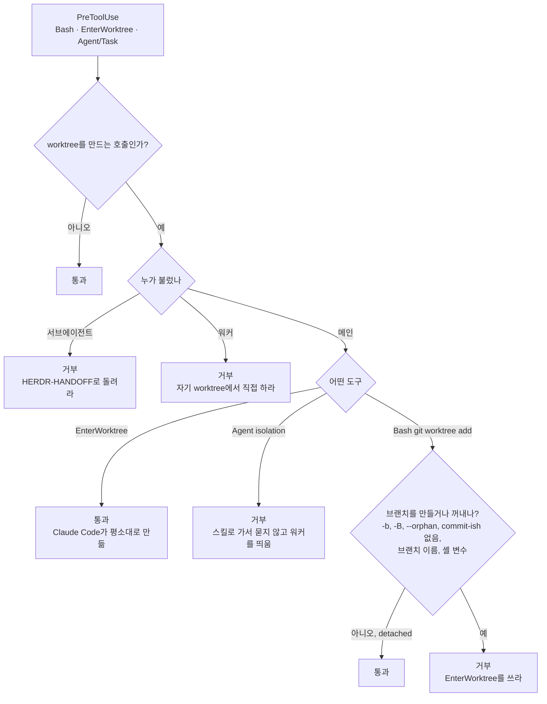
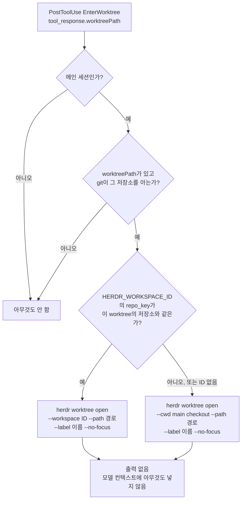
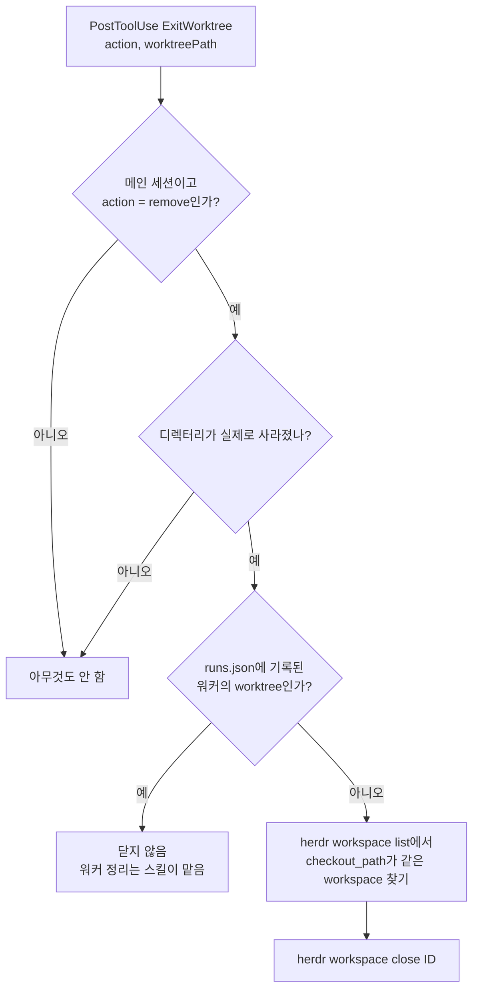

# herdr-parallel-worktree: 메인 세션의 worktree는 막지 않고 사이드바에 등록 — 설계

- 날짜: 2026-10-13
- 기준: `93cf141` (0.5.0)
- 측정 환경: Claude Code 2.1.296, herdr 0.9.0

## 1. 배경: 거부하고 돌려보내는 방식의 마찰

지금까지 hook은 herdr 안에서 worktree를 만드는 모든 호출을 거부하고 스킬로 돌려보냈다. 실제 세션 두 건에서 이 방식이 어긋났다.

- **kb-skills (종료 결과 재정립).** 승인된 계획은 "이 세션이 worktree에서 작업"이었다. `superpowers:using-git-worktrees`를 따라 만든 `git worktree add`가 거부되었고, 모델은 스킬을 불러 0단계 확인 질문에서 "워커에게 맡김 / 이 세션에서 직접"을 다시 물었다. 이미 승인한 계획을 hook이 "새 워커에게 맡기기"로 바꿨으므로, 다시 묻는 것은 모델 입장에서 맞는 행동이었다.
- **saju (기준 커밋 테스트 수 세기).** 읽기용 임시 checkout이 거부되었다. 모델은 스킬을 부르지 않고 `git archive | tar`로 돌아갔다. 워커를 띄우는 스킬이 이 목적에 맞지 않으니 이것도 맞는 판단이었다.

원인은 같다. hook이 "worktree를 만든다"를 "병렬 워커에게 맡긴다"로 읽었다. 스킬이 실제로 다루는 영역은 다른 에이전트에게 일을 맡기는 경우뿐인데, 이 세션 자신의 격리와 읽기용 checkout까지 워커 띄우기로 바꿨다. Claude Code는 거부된 도구 호출을 "사용자가 거절한 것"으로 다루라고 모델에게 가르친다. 그래서 계획 도중의 거부는 다시 묻기나 우회로 이어졌다.

## 2. 측정한 사실

| # | 사실 | 설계에 미치는 영향 |
|---|---|---|
| G1 | 기본 `EnterWorktree(name)`: `.claude/worktrees/<name>`, 브랜치 `worktree-<name>`, 기준은 origin의 기본 브랜치. `.worktreeinclude`에 적힌 무시 파일을 복사한다 | 이 동작은 그대로 둔다 |
| G2 | 기본 `ExitWorktree(remove)`: 디렉터리와 **브랜치까지** 지운다 | 지우기도 Claude Code에 맡긴다 |
| G3 | 기본 worktree 격리 서브에이전트: 변경 없이 끝나면 worktree를 자동으로 지운다 | — |
| G4 | `WorktreeCreate` hook을 등록하면 Claude Code는 G1~G3를 하지 않는다. hook이 만든 서브에이전트 worktree는 끝난 뒤에도 남았다(서브에이전트 종료 때는 `WorktreeRemove`가 불리지 않음). 이 hook에는 matcher가 없어 herdr 밖 세션에도 걸린다 | `WorktreeCreate`는 쓰지 않는다 (§4) |
| G5 | PostToolUse `EnterWorktree`의 `tool_response`에 `worktreePath`, `worktreeBranch`가 있다. `ExitWorktree`에는 `action`, `worktreePath`가 있다 | 만든 뒤 등록할 수 있다 |
| G6 | `herdr worktree open --path <.claude/worktrees/x>`는 workspace ID를 돌려준다. 같은 경로를 다시 열면 `already_open: true`다 | 두 번 불려도 안전하다 |
| G7 | `--cwd`로 열면 저장소에 열린 workspace가 없을 때 원본 저장소용 workspace가 하나 더 생긴다 | 세션의 workspace가 같은 저장소면 `--workspace`로 붙인다 (스킬 1단계와 같은 규칙) |
| G8 | worktree 디렉터리가 지워진 뒤에도 herdr workspace는 남는다. `herdr workspace list`가 `worktree.checkout_path`를 계속 보여 준다 | 상태 파일 없이 경로로 찾아 `herdr workspace close`로 닫는다 |

## 3. 설계

규칙은 `HERDR_ENV=1`이고 config의 `hooks`가 `"off"`가 아닐 때만 동작한다. 바뀐 칸은 메인 세션 열과 R8뿐이다.

| ID | 이벤트 / 도구 | 걸리는 조건 | main | sub | worker | worker-sub |
|---|---|---|---|---|---|---|
| R1 | PreToolUse `Bash` | 명령 위치의 `git … worktree add` | 브랜치를 만들거나 꺼내면 `DENY_MAIN_BASH` (EnterWorktree 안내), detached checkout은 통과 | DENY_SUB | DENY_WORKER | DENY_SUB |
| R2 | PreToolUse `EnterWorktree` | `path` 없음 | **통과** | DENY_SUB | DENY_WORKER | DENY_SUB |
| R3 | PreToolUse `Agent`/`Task` | `isolation == "worktree"` | `DENY_MAIN_AGENT` (스킬로) | DENY_SUB | DENY_WORKER | DENY_SUB |
| R4 | PreToolUse 쓰기 도구 | 자기 worktree 밖, 주인 있음 | 통과 | DENY_SUB | DENY_WORKER_WRITE | DENY_SUB |
| R6 | PostToolUse `Agent`/`Task` | 항상 | NOTE_HANDOFF | — | — | — |
| R7 | PostToolUse(Failure) `Bash` | 다른 worktree를 실제로 바꿈 | — | 관찰 | 관찰 | 관찰 |
| R8 | PostToolUse `EnterWorktree` / `ExitWorktree` | `worktreePath` 있음 | 열기 / 지워졌으면 닫기 | — | — | — |

**detached checkout 판정 (R1).** `--detach`나 `-d`가 있으면 detached다. `-b`, `-B`, `--orphan`이 있으면 브랜치다. commit-ish가 없으면 git이 경로 이름으로 브랜치를 만드므로 브랜치다. commit-ish가 로컬 브랜치이거나, 원격 하나에만 있는 브랜치 이름이면(git이 로컬 브랜치를 만든다) 브랜치다. 셸 변수처럼 실행해야 알 수 있는 값이면 브랜치로 본다. 나머지는 detached다. 명령을 이해하지 못하면 전처럼 거부한다. 리다이렉션(`2>&1`)은 인자로 보지 않는다.

**메시지.** 메인 세션에게 주던 예외 조항("사용자가 직접 요청했으면 `!`로 실행하거나 hook을 끄라고 알려라")을 뺐다. 모델이 "사용자가 직접 요청한 건가?"를 따지다 멈추게 만들던 부분이다. 각 메시지는 요청한 일을 해 주는 도구 하나를 가리킨다. Bash에는 `EnterWorktree`, Agent 격리에는 스킬이다.

**시작 전에 묻지 않는다 (사용자 결정 2026-10-13).** 이 스킬로 에이전트를 새 pane에 띄우기로 했다면, 사용자는 이미 결정한 것이다. 직접 요청했거나, 이 hook을 설치해 그렇게 하도록 정해 두었다. 그래서 스킬은 시작 전에 아무것도 묻지 않는다. 알리거나 정할 것이 있으면 띄운 뒤 보고에 담는다. 커밋 안 된 변경, brief에 적은 가정, 정리 후보, 다섯 개 이상 동시 실행, main checkout handoff가 여기에 해당한다. 워커는 사이드바에서 보이고 언제든 고치거나 멈출 수 있으므로, 시작 전 확인이 막아 주던 일은 시작 뒤 보고로 충분하다. 확인을 받는 것은 되돌릴 수 없는 정리(worktree 삭제)뿐이다. 거부 메시지도 이것이 사용자가 정한 설정이라고 밝혀, 모델이 거부를 "사용자가 거절했다"로 읽고 되묻지 않게 한다. 사용자가 hook 자체를 묻지 않는 한 hook을 끄라는 제안도 하지 않는다.

**R8 안전장치.** 메인 세션만 등록한다. `ExitWorktree`는 `action`이 `remove`이고 디렉터리가 실제로 사라졌을 때만 닫는다. `runs.json`에 기록된 워커의 worktree는 닫지 않는다. 그 정리는 스킬이 맡는다. herdr 호출이 실패해도 출력이 없고, 도구 결과에도 영향이 없다.

### 흐름

PreToolUse: worktree를 만드는 호출

PostToolUse: EnterWorktree

PostToolUse: ExitWorktree

## 4. 버린 대안: WorktreeCreate로 대신 만들기

처음 안은 `WorktreeCreate` hook에서 `herdr worktree create`로 만들고 경로를 돌려주는 것이었다. 이 hook은 기본 생성을 덧붙이는 게 아니라 **교체**한다(G4). 그래서 G1~G3를 다시 구현해야 하고, matcher가 없어 herdr 밖 사용자의 worktree 동작까지 바뀐다. 서브에이전트 worktree가 남는 것은 실측에서 이미 확인했다. "herdr 밖에서는 아무것도 바꾸지 않는다"는 원칙과 맞지 않아 버렸다.

## 5. 알려진 한계

- `claude --worktree`로 시작한 세션의 worktree는 도구 호출을 거치지 않아 사이드바에 등록되지 않는다.
- 세션을 끝낼 때 Claude Code가 묻는 "지우기"를 고르면, 도구 호출이 없어 workspace가 남는다. 남은 workspace는 지워진 경로를 가리키므로 사이드바에서 닫으면 된다.
- 시작 전에 묻지 않으므로, brief에 적은 가정이 틀렸으면 워커가 이미 그 가정으로 일을 시작한 뒤에 바로잡게 된다. 보고에 가정을 적는 이유다.

## 6. 검증

- 단위 테스트: `python3 -m unittest discover -s skills/herdr-parallel-worktree/tests`. 등록(R8), detached 판정, 메시지, 진입점(가짜 `herdr`를 PATH에 둔 실제 실행)을 포함한다.
- 실제 `claude -p`: `tests/live_hooks.py`는 C20~C24를 더해 24개를 확인한다. herdr는 `tests/fake_herdr.py`로 바꾼다. 사용자가 `~/.claude/settings.json`에 등록한 hook(옛 코드일 수 있음)은 꺼진 data 디렉터리로 조용히 시킨다.
- old/new 비교(skill-creator, sonnet). 2회차는 각 설정의 SKILL.md가 실제로 로드되게 했다. 저장소 `.claude/skills`에 링크를 두고 `--setting-sources project,local`로 사용자 설정을 뺐으며, superpowers는 `--plugin-dir`로 다시 붙였다. 시나리오 9개에서 새 버전 100%, 옛 버전 38%였다.
  - 자연어 요청("worktree를 하나 만들어서 README에 Usage 추가하고 커밋"): 새 버전은 3회 모두 한 턴 안에 끝냈다(약 17초). 옛 버전은 3회 모두 거부된 뒤 워커 스킬로 넘어가 멈췄다(약 38초).
  - 위임 요청("herdr 워커 두 개로 나눠서 동시에 진행해 줘"): 새 버전은 3회 모두 묻지 않고 두 워커를 띄운 뒤 보고했다. 옛 버전은 3회 모두 "이대로 두 워커를 동시에 시작할까요?"에서 멈췄다.
  - Agent 격리: 새 버전은 거부를 따라 스킬로 가서 묻지 않고 워커를 띄웠고, hook 끄기를 꺼내지 않았다.
- `tests/live_skill.py`는 이 checkout의 스킬을 로드하도록 바꿨다. handoff를 받은 뒤 시작 허락을 구하지 않는지 보는 항목을 더했다. 이 항목은 옛 스킬의 "Please confirm" 응답에서는 실패한다.
