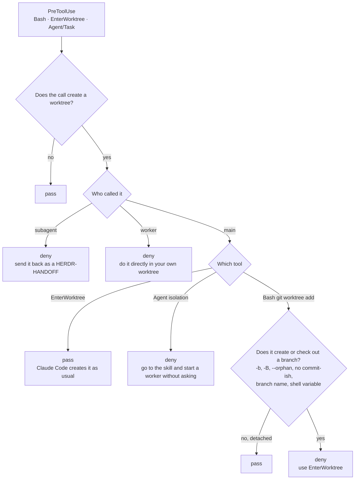
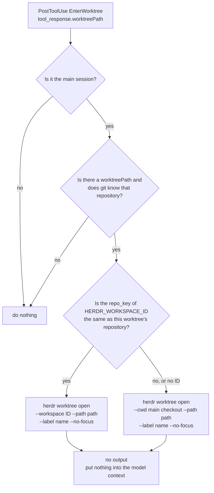
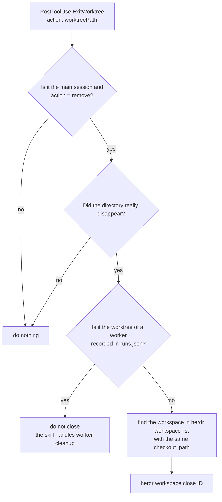

# herdr-parallel-worktree: do not block the main session's worktree, register it in the sidebar — design

- Date: 2026-10-13
- Baseline: `93cf141` (0.5.0)
- Measured with: Claude Code 2.1.296, herdr 0.9.0

## 1. Background: the friction of denying and sending back

Until now the hook denied every call that creates a worktree inside herdr and sent it back to the skill. This went wrong in two real sessions.

- **kb-skills (redefining the end result).** The approved plan was "this session works in a worktree". The `git worktree add` made by following `superpowers:using-git-worktrees` was denied, and the model loaded the skill and asked the step 0 confirmation question again: "hand it to a worker / do it myself in this session". The hook had turned an already approved plan into "hand it to a new worker", so asking again was the right behavior for the model.
- **saju (counting the tests at the baseline commit).** A temporary checkout for reading was denied. The model did not call the skill and went back to `git archive | tar`. The skill that starts workers does not fit this purpose, so this was also the right judgment.

The cause is the same. The hook read "create a worktree" as "hand it to a parallel worker". The skill covers only the case of handing work to another agent, but the hook turned this session's own isolation and read-only checkouts into worker launches too. Claude Code teaches the model to treat a denied tool call as "the user refused it". So a denial in the middle of a plan led to asking again or to a workaround.

## 2. Measured facts

| # | Fact | Effect on the design |
|---|---|---|
| G1 | Default `EnterWorktree(name)`: `.claude/worktrees/<name>`, branch `worktree-<name>`, based on origin's default branch. It copies the ignored files listed in `.worktreeinclude` | Keep this behavior as it is |
| G2 | Default `ExitWorktree(remove)`: deletes the directory and **the branch too** | Leave deletion to Claude Code as well |
| G3 | Default worktree-isolated subagent: if it ends with no changes, the worktree is deleted automatically | — |
| G4 | If a `WorktreeCreate` hook is registered, Claude Code does not do G1 to G3. A subagent worktree made by the hook remained after it ended (`WorktreeRemove` is not called when a subagent ends). This hook has no matcher, so it also applies to sessions outside herdr | Do not use `WorktreeCreate` (§4) |
| G5 | The `tool_response` of PostToolUse `EnterWorktree` has `worktreePath` and `worktreeBranch`. `ExitWorktree` has `action` and `worktreePath` | It can be registered after creation |
| G6 | `herdr worktree open --path <.claude/worktrees/x>` returns the workspace ID. Opening the same path again gives `already_open: true` | Safe even if called twice |
| G7 | Opening with `--cwd` creates one more workspace for the source repository when the repository has no open workspace | If the session's workspace is the same repository, attach with `--workspace` (the same rule as skill step 1) |
| G8 | The herdr workspace remains after the worktree directory is deleted. `herdr workspace list` keeps showing `worktree.checkout_path` | Find it by path without a state file and close it with `herdr workspace close` |

## 3. Design

The rules work only when `HERDR_ENV=1` and the config's `hooks` is not `"off"`. The only cells that changed are the main session column and R8.

| ID | Event / tool | Condition | main | sub | worker | worker-sub |
|---|---|---|---|---|---|---|
| R1 | PreToolUse `Bash` | `git … worktree add` in command position | if it creates or checks out a branch, `DENY_MAIN_BASH` (EnterWorktree guidance); a detached checkout passes | DENY_SUB | DENY_WORKER | DENY_SUB |
| R2 | PreToolUse `EnterWorktree` | no `path` | **pass** | DENY_SUB | DENY_WORKER | DENY_SUB |
| R3 | PreToolUse `Agent`/`Task` | `isolation == "worktree"` | `DENY_MAIN_AGENT` (to the skill) | DENY_SUB | DENY_WORKER | DENY_SUB |
| R4 | PreToolUse write tools | outside its own worktree, has an owner | pass | DENY_SUB | DENY_WORKER_WRITE | DENY_SUB |
| R6 | PostToolUse `Agent`/`Task` | always | NOTE_HANDOFF | — | — | — |
| R7 | PostToolUse(Failure) `Bash` | really changed another worktree | — | observe | observe | observe |
| R8 | PostToolUse `EnterWorktree` / `ExitWorktree` | has `worktreePath` | open / close if deleted | — | — | — |

**Detached checkout decision (R1).** If `--detach` or `-d` is present, it is detached. If `-b`, `-B`, or `--orphan` is present, it is a branch. With no commit-ish, git creates a branch named after the path, so it is a branch. If the commit-ish is a local branch, or a branch name that exists on only one remote (git creates a local branch), it is a branch. A value that is known only by running it, such as a shell variable, is treated as a branch. The rest are detached. If the command is not understood, deny as before. A redirection (`2>&1`) is not treated as an argument.

**Message.** The exception clause that was given to the main session ("if the user asked directly, tell them to run it with `!` or turn the hook off") was removed. It was the part that made the model stop to ask "did the user ask for this directly?". Each message points to one tool that does the requested job: `EnterWorktree` for Bash, the skill for Agent isolation.

**Do not ask before starting (user decision 2026-10-13).** If it was decided to start an agent in a new pane with this skill, the user has already decided. They asked for it directly, or they installed this hook to make it work that way. So the skill asks nothing before starting. Anything to announce or decide goes in the report after starting. This covers uncommitted changes, assumptions written in the brief, cleanup candidates, five or more running at once, and a main checkout handoff. A worker is visible in the sidebar and can be fixed or stopped at any time, so reporting after the start is enough for what a pre-start confirmation used to prevent. Only the irreversible cleanup (deleting a worktree) gets a confirmation. The denial messages also state that this is the user's setting, so the model does not read a denial as "the user refused" and ask again. Unless the user asks about the hook itself, the model also does not suggest turning the hook off.

**R8 safeguards.** Only the main session is registered. `ExitWorktree` closes only when `action` is `remove` and the directory has really disappeared. It does not close the worktree of a worker recorded in `runs.json`. The skill handles that cleanup. If the herdr call fails, there is no output and no effect on the tool result.

### Flow

PreToolUse: a call that creates a worktree

PostToolUse: EnterWorktree

PostToolUse: ExitWorktree

## 4. Rejected alternative: create with WorktreeCreate instead

The first proposal was to create with `herdr worktree create` in a `WorktreeCreate` hook and return the path. This hook does not add to the default creation, it **replaces** it (G4). So G1 to G3 would have to be reimplemented, and with no matcher it would change the worktree behavior of users outside herdr as well. That subagent worktrees remain was already confirmed by measurement. It was rejected because it does not fit the principle "change nothing outside herdr".

## 5. Known limits

- The worktree of a session started with `claude --worktree` does not go through a tool call, so it is not registered in the sidebar.
- If you choose "delete" at the prompt Claude Code shows when ending a session, there is no tool call, so the workspace remains. The remaining workspace points to a deleted path, so close it in the sidebar.
- Because it does not ask before starting, if an assumption written in the brief is wrong, it is corrected after the worker has already started work on that assumption. This is why the report states the assumptions.

## 6. Verification

- Unit tests: `python3 -m unittest discover -s skills/herdr-parallel-worktree/tests`. They include registration (R8), the detached decision, messages, and the entry point (a real run with a fake `herdr` on PATH).
- Real `claude -p`: `tests/live_hooks.py` adds C20 to C24 and checks 24 items. herdr is replaced with `tests/fake_herdr.py`. The hooks the user registered in `~/.claude/settings.json` (which may be old code) are silenced by pointing them to a data directory that is turned off.
- old/new comparison (skill-creator, sonnet). In the second round, each setting's SKILL.md was made to load for real. A link was put in the repository's `.claude/skills`, user settings were left out with `--setting-sources project,local`, and superpowers was attached again with `--plugin-dir`. Across 9 scenarios, the new version scored 100% and the old version 38%.
  - Natural-language request ("make a worktree, add Usage to the README, and commit"): the new version finished within one turn all 3 times (about 17 seconds). The old version was denied all 3 times, then moved to the worker skill and stopped (about 38 seconds).
  - Delegation request ("split it between two herdr workers and run them at the same time"): the new version started two workers without asking all 3 times and then reported. The old version stopped at "Shall I start the two workers at the same time as is?" all 3 times.
  - Agent isolation: the new version followed the denial to the skill and started a worker without asking, and did not bring up turning the hook off.
- `tests/live_skill.py` was changed to load this checkout's skill. It adds an item that checks the model does not ask permission to start after receiving a handoff. This item fails on the old skill's "Please confirm" response.
